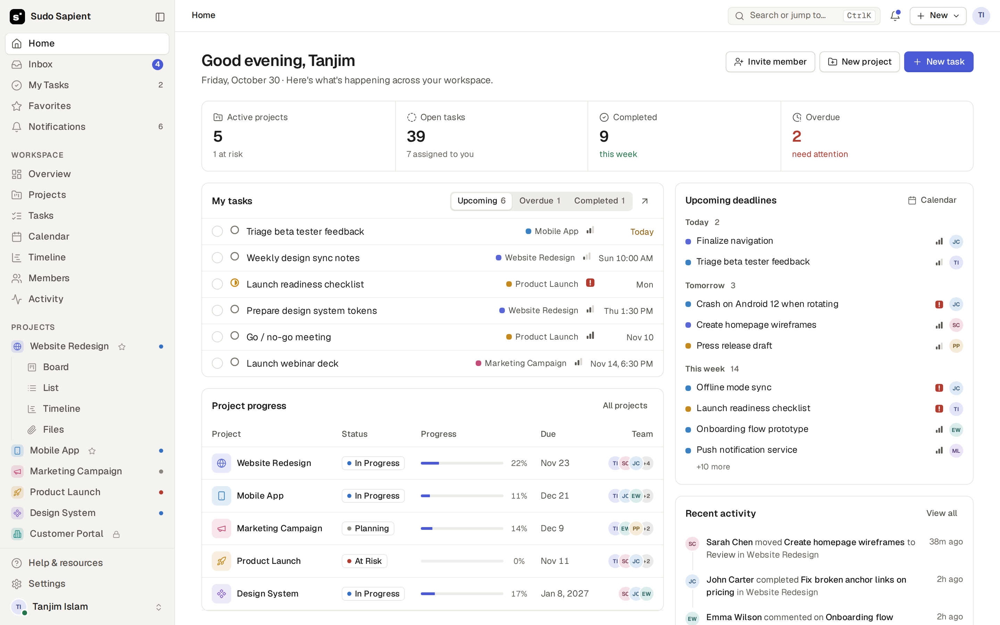

# Sudo Sapient

A calm, structured project management workspace: home dashboard, inbox, my tasks, projects with
board / list / table / calendar / timeline / files views, members, teams, activity and settings.

The client is plain JavaScript ES modules and CSS, bundled by [Vite](https://vite.dev), with no UI
framework. The server is [Hono](https://hono.dev) on Node's built-in SQLite (`node:sqlite`).



## Getting started

Requires Node.js 24 (`.nvmrc`) and pnpm (`corepack enable`).

```bash
pnpm install
pnpm dev          # API on :8787 + Vite on http://localhost:5173 (proxies /api), both reloading
pnpm db:seed      # optional: load the demo workspace; sign in as hello@gr8rstudio.com / gr8r-demo-123
pnpm db:backup    # copy the database and new uploads to BACKUP_DIR; see Backups
pnpm build        # client production build in dist/
pnpm start        # production server: API + dist/ on :8787
pnpm test         # API tests (Vitest, in-memory database)
pnpm test:e2e     # builds, starts a throwaway server, runs the Playwright journeys
pnpm lint         # ESLint
pnpm format       # Prettier
```

The first account created becomes the workspace **Owner** and goes through setup. In production
that first sign-up needs the setup link: set `SETUP_TOKEN` and open `APP_URL/#setup/<token>`, or
leave it unset and use the one-off link the server prints to its log while no workspace exists
(`[setup] … /#setup/…`). Locally (`pnpm dev`) the first sign-up needs nothing. After that the
workspace is invite-only: invite people from Members (they get an email), or have an Owner or Admin
share the reusable invite link. An invited address can only be claimed through its own invite link.
Emails are sent through [Resend](https://resend.com). Without `RESEND_API_KEY`, `pnpm dev` prints them
(links included) to the API console and the verify / reset screens offer the link directly. If Vite
picks a port other than 5173, set `APP_URL` so emailed links point at it.

### `NODE_ENV`

Only `NODE_ENV=development` (set by `pnpm dev`, `pnpm db:seed`) and `NODE_ENV=test` relax security.
Every other value, and no value at all, runs with production behaviour: `Secure` cookies, the setup
token for the first account, and emailed links never returned by the API. So `staging`, a typo, or
starting `node server/index.js` without it all fail closed. `pnpm start` and the Docker image set
`production`. In production without `RESEND_API_KEY` no email is sent: the server warns at startup
and logs only the recipient and subject of each message, not its link, unless you set
`LOG_EMAIL_LINKS=true` (then anyone who can read the logs can use those links).

## Configuration

All settings are environment variables with local defaults; see [`.env.example`](.env.example).
For production you need at least `APP_URL`, persistent `DATABASE_PATH` / `UPLOAD_DIR`, `RESEND_API_KEY` and a `MAIL_FROM` address on a domain verified in Resend
(sign-up requires email verification). Set `SECRET_KEY` (32 bytes or more, e.g. `openssl rand -base64 32`)
so two-factor secrets are encrypted at rest (AES-256-GCM); existing ones are encrypted the next time
the server starts with it. Keep it safe and don't change it: without the same key, authenticator
codes stop working (recovery codes still do). Without it, secrets stay unencrypted and production
startup warns. Behind a reverse proxy, set `TRUST_PROXY` to the number of
proxies that append to `X-Forwarded-For` (`true` means one): the client address is read that many
entries from the right, because anything further left is written by the client. Rate limits key on
that address, so getting this wrong either lets clients pick their own IP or puts everyone behind
the proxy's.

## How data flows

- **Bootstrap.** After sign-in the client loads `GET /api/bootstrap`: the whole workspace graph this
  person may see (projects, tasks, comments, members, notifications, files, …), in the same shape
  the UI renders from `S.data`.
- **Writes.** Actions keep mutating `S.data` and calling `save()`. `shell/sync.js` diffs `S.data`
  against what the server last confirmed and sends field-level operations to `POST /api/sync`.
  The server (`server/sync/`) validates each one, checks permissions, applies side effects (task
  keys, cascading deletes, notifications, invite emails) and returns the canonical record; a
  rejected change is rolled back on the client with a toast. `<html data-sync>` shows
  `saving` / `saved` / `offline`; changes made while offline are retried.
- **Live updates.** Other people's changes arrive over Server-Sent Events (`GET /api/events`) and are
  merged in, filtered to what each person can see.
- **Per-person data** (preferences, view settings, favourites, sidebar order, notification
  preferences) is stored per account, not in the browser.
- **Files** stream to `POST /api/files` and are served only to people who can see the project.
- **Project access.** A project is open to the whole workspace (every non-Guest can edit) or private
  (`private: true`, set from the share dialog's General access; `access` mirrors it). People listed
  on a project get the share dialog's permission: Can view, Can comment (own comments and
  reactions), Can edit (tasks, files, events, saved views) or Full access (also members, privacy,
  permissions, lead, archiving and deleting). The lead and the project's creator have full access;
  listed Guests default to Can comment. Owners and Admins can always change a project's settings,
  even a private one they're not in, but only see its work once they add themselves. People who
  can't open a project receive only a stub (name, icon, colour, lead) for the locked card;
  Guests receive nothing, and only see the email addresses of people they share a project with.
  Listing someone on a project gives them exactly the permission shown, even on a project open to
  the whole workspace (so "Can view" there is less than not being listed); the share dialog says so.
  Deleting work in a project is only announced to people who could see it. One helper, `src/core/access.js`, decides all of this for the server
  (sync rules, uploads, notifications, bootstrap, live updates) and the client (which hides what
  would be refused).
- **Account.** Settings → Account changes the sign-in email (confirmed from a link sent to the new
  address; the old one is told when it's requested and again when it's done), downloads your data
  as JSON (`GET /api/me/export`: profile, preferences, your notifications, tasks assigned to you and
  your comments in projects you can see; the Owner also gets the workspace's people, teams and every
  project's settings, but the work of only the projects they can open, never password hashes,
  secrets or tokens; each workspace export is logged and appears in Activity), and deletes your
  account (password required; Owners hand ownership over first).
- **Jobs** (`server/jobs.js`) send due-date reminders, overdue alerts and daily digests.
- **Push.** Turning on a Push preference subscribes the browser (Web Push, VAPID); notifications
  arrive even when the app is closed, and clicking one opens the task. Browsers only allow push on
  HTTPS (or localhost); on iPhone/iPad the app must be added to the Home Screen first. A subscription
  belongs to the session that made it and is deleted when that session ends (sign out, revoked,
  password change or reset, expiry, removal); the browser subscribes again after its next sign-in.

## Installable app (PWA)

`public/manifest.webmanifest` and the service worker (`public/sw.js`) make the app installable.
The worker caches the app shell and build assets so it opens without a connection (it then shows
that the server can't be reached); API responses are never cached. In development it's registered
in a pass-through mode so Vite's hot reload is unaffected.

## Brand

The wordmark (`public/logo.svg`, `LOGO` in `src/core/icons.js`), the stacked app icon
(`public/icon.svg`, `public/icons/*.png`) and the "s" monogram (favicon, small marks) are outlines of
Archivo Black (SIL Open Font License) with the square accent from the original mark.

## Security

Passwords are hashed with scrypt; sessions are random tokens in `HttpOnly`, `SameSite=Lax` cookies
(stored hashed). Mutating requests require an `X-Requested-With` header (CSRF). Auth endpoints are
rate-limited per client IP (see `TRUST_PROXY`), and each email is locked for 15 minutes after 10
failed sign-ins from anywhere. So that strangers can't use that lock to keep the owner out, a
browser that has signed in to the account before carries a **device cookie** (`gr8r_dev`: random,
`HttpOnly`, one year, path `/api/auth`, stored hashed, the OWASP pattern): its sign-ins skip the
per-email lock and have their own limit of 10 failures per 15 minutes, after which it counts as a
stranger again. Signing out keeps the device cookie; resetting the password forgets every device of
the account, and changing it forgets all but the browser that changed it. Two-factor uses TOTP (each code is accepted once) with single-use
recovery codes; a sign-in waiting for its code ends after 5 wrong ones, and after 10 wrong codes in
15 minutes for an account (whatever the session) two-factor sign-in pauses for 15 minutes and the
person gets an email. Setting two-factor up needs the current password, turning it off needs the
password or a current code, and the Owner can reset someone else's (lost phone) with their own
password, which emails that person and signs them out. Changing the password or email signs out
every other session, and live-update streams close when their session ends. A pending email change
is cancelled by a password change or reset, revoking sessions, turning two-factor on or off, or
deleting the account. Request bodies are capped (64 KB for auth, 10 MB for sync, 1 MB elsewhere;
uploads have their own `MAX_UPLOAD_MB`). Responses carry a strict CSP (scripts only from the app,
`base-uri 'none'`, `form-action 'self'`, `object-src 'none'`); served files get their own sandboxing
CSP, except inline PDFs (Chromium won't render a sandboxed PDF), which get a CSP without scripts or
other origins. Everything people type is escaped when rendered. Task descriptions are the one rich-text
field: the server sanitises them on write (sanitize-html) and the client again when rendering or
pasting (DOMPurify), both against the editor's own allowlist (`src/core/rich-text.js`: paragraphs,
bold, italic, lists, a heading and http(s)/mailto links). Fields the UI only offers choices for are
checked on write too: repeat settings, event times, reaction emoji, saved-view filters; file type and
size come from the stored file, and attachments and file links only ever point at `/api/files/`. Project permissions (above) are enforced on
the server for every write, upload, notification, bootstrap and live update: nobody is notified or
emailed about a project they can't see, and work can't be assigned to them. Emailed links are wiped
from the outbox once the mail is sent, and sent mail is deleted after 30 days. Push subscriptions
are only accepted on the browsers' push services (FCM, Mozilla, Apple, Windows), so the server never
posts to arbitrary hosts. Invites (50 an hour per person), invite links (10 an hour) and access
requests are rate-limited too; asking for access answers the same whether or not the project exists.

## Project structure

```
index.html              HTML entry; loads src/main.js
public/favicon.svg      brand mark
vite.config.js          Vite config, including the Lucide icon-subset plugin
eslint.config.js        lint rules (ESLint flat config); formatting by Prettier (.prettierrc.json)
.github/workflows/      CI: lint, format check, build
docs/preview.png        README screenshot
src/
  main.js               entry: imports styles and modules, then boots the app
  styles/
    index.css           imports every stylesheet in cascade order
    tokens.css          colours, spacing, type, radius, the shared --gutter
    base.css  components.css  shell.css  panels.css  overlays.css  states.css  motion.css  responsive.css
    views/              list, board, table, calendar, timeline, projects & files
    pages/              settings, auth & onboarding
  core/                 utilities, constants, icons, store (state + lookups), theme, API client
  ui/                   shared render helpers, toasts, the select dropdown
  shell/                render loop and router, sidebar/topbar layout, skeletons, view engine, sync
  components/           task list renderer
  pages/                one module per route
  views/                project views: board, table, calendar, timeline, files, overview
  overlays/             task drawer, modals, popovers, context menu, command palette
  features/             teams, subtasks, archive (rendering)
  actions/              user actions, event wiring, keyboard shortcuts, drag and drop, session (auth)
server/
  index.js              process entry: HTTP server, housekeeping, scheduled jobs
  app.js                Hono app (routes, security headers, static files in production)
  auth.js  routes/      sessions; /api/auth, /api/files, bootstrap/sync/events, workspace endpoints
  sync/                 bootstrap graph, sync engine, per-collection rules and schemas
  notify.js  jobs.js    notifications (+ email), reminders and digests
  migrations/           migrations, applied on start in name order: .sql, or .js exporting `default (db)` for data fixes
  scripts/              dev-only demo seed; backup (database + uploads)
test/server/            API tests (Vitest)
e2e/                    user journeys (Playwright)
```

### Layers

Dependencies point downward:

1. `core/` depends on nothing else in the app.
2. `ui/`, `shell/`, `components/`, `pages/`, `views/`, `overlays/` and `features/` render HTML from state.
3. `actions/` change state and re-render. Each action module registers its handlers on the
   shared action table (`A`) when it loads, so `main.js` imports them after `actions/actions.js`.

## Conventions

- **Rendering:** each page or view is a function that returns an HTML string from the store
  (`S`). `render()` rebuilds the shell and keeps focus and scroll positions.
- **Interactions:** elements declare `data-a="actionName"`. `actions/events.js` delegates the
  click to `A.actionName`. Inputs use `data-in`, blur handlers use `data-blur`.
- **Layout:** every page edge uses `var(--gutter)`, so the breadcrumb, page header, toolbar,
  list, table and board start on the same line.
- **Dropdowns:** write a normal `<select class="select">`. `ui/select.js` renders it as the
  design-system menu and keeps the native element as the source of truth.
- **Icons:** call `ic('name')` with any [Lucide](https://lucide.dev) icon name. The
  `virtual:icons` plugin bundles only the icons the source uses.

## Continuous integration

Every push and pull request runs lint, the format check, the API tests, a production build and the
e2e journeys (`.github/workflows/ci.yml`).

## Deploy

The app is one Node process with a SQLite file and an uploads directory, so it needs a host with a
persistent disk (a VM, Fly.io, Railway, Render, …), not a static or serverless host. The
`Dockerfile` builds an image that serves everything on port 8787 and keeps data in the `/data`
volume (owned by the image's `node` user). Its `HEALTHCHECK` calls `GET /api/health`, which also
runs a query and answers 503 when the database isn't usable.

On first start in production, open the setup link (see Getting started) to create the Owner.

In production the server logs one line per request (method, path, status, time; never bodies,
cookies, query strings or tokens) and logs unhandled errors to stderr. There is no error tracker
built in; ship the logs to whatever you use. On `SIGTERM`/`SIGINT` it closes live-update streams,
lets open requests finish, closes the database and exits (forced after 3 seconds).

### Backups

`pnpm db:backup` (or `node server/scripts/backup.js` where there's no pnpm, such as the Docker
image: `docker exec <container> node server/scripts/backup.js`) writes a consistent copy of the
database (SQLite `VACUUM INTO`, safe while the app runs) and mirrors uploaded files into
`BACKUP_DIR`:

```
BACKUP_DIR/
  gr8r-20261031T030000Z.db    one per run, the newest BACKUP_KEEP (default 14) are kept
  uploads/ab/b…               every uploaded file, copied once (stored files never change)
```

Uploads are copied incrementally and never removed from the mirror, so every kept database copy
still has its files. Without `BACKUP_DIR` the script writes to `backups` next to the database
(`/data/backups` in the Docker image). With `BACKUP_DIR` set, the running server also takes one a
day.

**A backup on the same disk or volume as the data is not a backup**: it survives a bad deploy or a
mistaken delete, not a lost disk. Point `BACKUP_DIR` at separate storage, e.g. in Docker mount
another volume at `/backups` (created writable for the app in the image) and set
`BACKUP_DIR=/backups`, then copy it off the machine as well.

To restore: stop the app, replace `DATABASE_PATH` with the backup file (and delete any
`DATABASE_PATH-wal` / `-shm` files next to it), copy `BACKUP_DIR/uploads` back into `UPLOAD_DIR`
(extra files there are harmless), then start the app. Migrations newer than the backup run on start.

### Known limits

- **One process.** Rate limits (per IP, per email, per device) and live-update connections are kept
  in memory, so the app runs as a single Node process; limits reset when it restarts. Running several
  instances would need a shared store behind `server/lib/rate-limit.js` and the sync engine's
  fan-out. (Two-factor lockouts are stored in the database.)
- **Reconnects re-bootstrap.** When the live-update stream drops, the client reloads the whole
  graph (`GET /api/bootstrap`) rather than catching up from a cursor; fine for a team-sized
  workspace, costly for a very large one.
- **No error tracker or metrics.** Only the logs described above, plus `GET /api/health`.
